# API Reference

Complete reference for all exported symbols in the `goflow` package.

Import path: `github.com/foomo/goflow`

## Types

### Stream

```go
type Stream[T any] struct {
    // unexported fields
}
```

The core type representing a lazy, context-aware, channel-backed sequence of elements. A stream carries a `context.Context`, a receive channel `<-chan T`, and optional `gofuncy.GoOption` values. Streams are consumed once -- after a terminal operation drains the channel, the stream is exhausted.

### KeyValue

```go
type KeyValue[K comparable, V any] struct {
    Key   K
    Value V
}
```

Holds a single key-value pair. Used by `OfMap` and related operators when streaming over map entries.

### Sender

```go
type Sender[T any] struct {
    // unexported fields
}

func (s *Sender[T]) Send(ctx context.Context, v T) error
func (s *Sender[T]) Try(ctx context.Context, v T) error
func (s *Sender[T]) Close(ctx context.Context) error
```

The writable entry point of a `Pipe` or `PipeFunc`. Safe for concurrent use; concurrent senders do not serialize behind each other.

- `Send` -- blocks until `v` is queued. Returns `ErrClosed` when the pipe is closed, or `ctx.Err()` when `ctx` is done.
- `Try` -- queues `v` without blocking. Returns `ErrFull` when the buffer is full and `ErrClosed` when the pipe is closed. Rejected elements count as dropped.
- `Close` -- closes the entry point. Implements a graceful closer such as keel's `Close(ctx) error`. For a `Pipe` sender it returns `nil` at once. For a `PipeFunc` sender it waits until `fn` returns and returns `fn`'s error; if `ctx` ends first, it cancels `fn`'s context and returns `ctx.Err()`.

### Option

```go
type Option func(*config)
```

Configures `Pipe`, `PipeFunc`, `Batch`, `ForEach` and `Process`. Each function ignores options that do not apply to it.

| Option | Applies to | Description |
|---|---|---|
| `WithBuffer(n int)` | Pipe, PipeFunc | Entry point channel capacity (default 0, unbuffered). |
| `WithName(name string)` | Pipe, PipeFunc | Pipeline name, used as the `goflow.pipeline.name` attribute and in the span name `process <name>` (default `"goflow.pipe"`). |
| `WithStageTracing()` | Pipe, PipeFunc | Keep gofuncy goroutine spans for the pipeline stages. Off by default, because the stages live as long as the pipeline. |
| `WithMeterProvider(mp metric.MeterProvider)` | Pipe, PipeFunc | Meter provider for pipeline metrics. Defaults to the otel global. |
| `WithTracerProvider(tp trace.TracerProvider)` | Pipe, PipeFunc | Tracer provider for linked consumer spans. Defaults to the otel global. |
| `MaxItems(n int)` | Batch | Flush a batch when it holds `n` elements. |
| `MaxBytes[T any](n int, size func(T) int)` | Batch | Flush a batch before its summed element size would exceed `n`. `T` must match the stream element type, otherwise Batch panics. |
| `MaxWait(d time.Duration)` | Batch | Flush a non-empty batch `d` after its first element arrived. |
| `WithErrorHandler(h ErrorHandler)` | ForEach, Process | Hand per-element errors to `h` and keep consuming. Errors are not retained. |
| `WithGroupOptions(opts ...gofuncy.GroupOption)` | Process | Options for the `gofuncy.Group` that runs the workers. |

### ErrorHandler

```go
type ErrorHandler = gofuncy.ErrorHandler // func(ctx context.Context, err error)
```

Receives per-element errors from `ForEach` and `Process` when set via `WithErrorHandler`. It is an alias of the gofuncy handler type, so one value serves both libraries.

### Errors

```go
var (
    ErrFull   = errors.New("goflow: pipe full")
    ErrClosed = errors.New("goflow: pipe closed")
)
```

- `ErrFull` -- returned by `Sender.Try` when the pipe buffer is full.
- `ErrClosed` -- returned when sending to a closed pipe. When the parent context closed the pipe, the error also wraps the context cause, so `errors.Is(err, context.Canceled)` still works.

### Constants

```go
const ScopeName = "github.com/foomo/goflow"
```

`ScopeName` is the OpenTelemetry instrumentation scope used by goflow. Attribute keys and flush, drop and stage enums are in the package `github.com/foomo/goflow/semconv`, for example `semconv.FlushReasonCount`. Typed instruments are in `github.com/foomo/goflow/semconv/goflowconv`.

---

## Constructors

### Of

::: code-group

<div class="vp-block active" data-title="Diagram"></div>

```go [Signature]
func Of[T any](ctx context.Context, items ...T) Stream[T]
```

:::

Returns a stream that emits the given items. The items are buffered into a channel with capacity equal to `len(items)`. If `items` is empty or the context is already cancelled, returns a closed empty stream.

**Parameters:**
- `ctx` -- context for cancellation propagation.
- `items` -- variadic elements to emit.

### From

::: code-group

<div class="vp-block active" data-title="Diagram"></div>

```go [Signature]
func From[T any](ctx context.Context, source <-chan T) Stream[T]
```

:::

Wraps an existing receive channel as a stream with the given context. Does not launch any goroutines. The caller is responsible for closing the channel when done.

**Parameters:**
- `ctx` -- context bound to the stream.
- `source` -- the channel to wrap.

### FromIter

::: code-group

<div class="vp-block active" data-title="Diagram"></div>

```go [Signature]
func FromIter[T any](ctx context.Context, seq iter.Seq[T]) Stream[T]
```

:::

Creates a stream from a Go 1.23 `iter.Seq[T]` by pushing elements into a channel in a background goroutine. The stream closes when the iterator is exhausted or the context is cancelled.

**Parameters:**
- `ctx` -- context for cancellation.
- `seq` -- the iterator to consume.

### FromFunc

::: code-group

<div class="vp-block active" data-title="Diagram"></div>

```go [Signature]
func FromFunc[T any](ctx context.Context, bufSize int, fn func(ctx context.Context, send func(T) error) error, opts ...gofuncy.GoOption) Stream[T]
```

:::

Creates a stream from a blocking function that sends items via the provided `send` callback. The function should block until it is done producing items and must respect context cancellation. The stream closes automatically when `fn` returns. If `fn` returns a non-nil error, it is handled by `gofuncy.Go`.

**Parameters:**
- `ctx` -- context for cancellation.
- `bufSize` -- channel buffer size controlling backpressure. A full buffer blocks the send callback.
- `fn` -- the producer function. Receives a context and a `send` callback.
- `opts` -- optional `gofuncy.GoOption` for error handling and tracing.

### Generate

::: code-group

<div class="vp-block active" data-title="Diagram"></div>

```go [Signature]
func Generate[T any](ctx context.Context, fn func() T) Stream[T]
```

:::

Returns an infinite stream where each element is produced by calling `fn`. The stream runs until the context is cancelled.

**Parameters:**
- `ctx` -- context for cancellation (required to stop the infinite stream).
- `fn` -- generator function called repeatedly for each element.

### Iterate

::: code-group

<div class="vp-block active" data-title="Diagram"></div>

```go [Signature]
func Iterate[T any](ctx context.Context, seed T, fn func(T) T) Stream[T]
```

:::

Returns an infinite stream: `seed`, `fn(seed)`, `fn(fn(seed))`, and so on. The stream runs until the context is cancelled.

**Parameters:**
- `ctx` -- context for cancellation.
- `seed` -- the first element emitted.
- `fn` -- function applied to the previous element to produce the next.

### OfMap

::: code-group

<div class="vp-block active" data-title="Diagram"></div>

```go [Signature]
func OfMap[K comparable, V any](ctx context.Context, m map[K]V) Stream[KeyValue[K, V]]
```

:::

Returns a stream of `KeyValue[K, V]` pairs from the given map. Iteration order is non-deterministic, matching Go map semantics. The channel is buffered to `len(m)`.

**Parameters:**
- `ctx` -- context for cancellation.
- `m` -- the map to stream over.

### Empty

::: code-group

<div class="vp-block active" data-title="Diagram">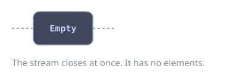</div>

```go [Signature]
func Empty[T any]() Stream[T]
```

:::

Returns an immediately closed, empty stream with a background context.

### Pipe

::: code-group

<div class="vp-block active" data-title="Diagram"></div>

```go [Signature]
func Pipe[T any](ctx context.Context, opts ...Option) (*Sender[T], Stream[T])
```

:::

Creates a writable stream entry point. Returns a `Sender` and the readable stream. The entry point closes when `ctx` is done or when `Sender.Close` is called. The stream and its stages run on `ctx` and stop when it ends; `Collect`, `Count`, `Iter`, `Iter2` and `FindFirst` still read the elements already buffered in the entry point; `ForEach`, `Process`, `Chan` and other stages stop with `ctx` and drop them. To drain a long-lived pipeline, use `PipeFunc`.

Queue gauges are only reported when `WithName` is set; the name must then be unique among live pipes. They are removed when the entry point closes.

For each element, Pipe captures the span context of the send `ctx` as a trace link. See [Metrics and Tracing](../guide/advanced.md#metrics-and-tracing).

**Parameters:**
- `ctx` -- parent context. When done, the entry point closes.
- `opts` -- `WithBuffer`, `WithName`, `WithMeterProvider`, `WithTracerProvider`.

**Returns:**
- `*Sender[T]` -- the writable entry point; safe to use from multiple goroutines.
- `Stream[T]` -- the readable stream.

### PipeFunc

::: code-group

<div class="vp-block active" data-title="Diagram"></div>

```go [Signature]
func PipeFunc[T any](ctx context.Context, fn func(context.Context, Stream[T]) error, opts ...Option) *Sender[T]
```

:::

Creates a draining pipeline: a Pipe plus the consumer `fn`, launched in a `gofuncy.Go` goroutine. Returns only the `Sender`.

`fn` and all stages it builds run on a context that `ctx` does not cancel. When `ctx` ends or `Close` is called, the entry point closes; `fn` keeps consuming the queued elements and must return when its stream ends. `Close(ctx)` waits for that. When `fn` returns, or `Close`'s `ctx` ends first, the stage context is cancelled and the queue gauges are removed. An `fn` that only waits for `ctx.Done()` keeps running until `Close` times out.

**Parameters:**
- `ctx` -- parent context. When done, the entry point closes.
- `fn` -- consumer function that processes the stream.
- `opts` -- same options as `Pipe`.

---

## Transformers

### Map

::: code-group

<div class="vp-block active" data-title="Diagram"></div>

```go [Signature]
func Map[T, U any](s Stream[T], fn func(context.Context, T) (U, error)) Stream[U]
```

:::

Returns a new stream by applying `fn` to each element of the source stream. If `fn` returns an error, the stream closes and the error is handled by `gofuncy.Go`. Propagates the source stream's options.

**Parameters:**
- `s` -- the source stream.
- `fn` -- transformation function. Receives the stream's context and the element.

### FlatMap

::: code-group

<div class="vp-block active" data-title="Diagram"></div>

```go [Signature]
func FlatMap[T, U any](s Stream[T], fn func(context.Context, T) Stream[U]) Stream[U]
```

:::

Applies `fn` to each element of the source stream, producing a sub-stream per element, and flattens the results into a single output stream. Sub-streams are consumed sequentially in source order.

**Parameters:**
- `s` -- the source stream.
- `fn` -- function that maps each element to a sub-stream.

### MapFilter

::: code-group

<div class="vp-block active" data-title="Diagram"></div>

```go [Signature]
func MapFilter[T, U any](s Stream[T], fn func(context.Context, T) (U, bool, error)) Stream[U]
```

:::

Maps and filters elements in a single pass. The boolean controls emission: `(val, true, nil)` emits `val`; `(_, false, nil)` skips the item; `(_, _, err)` stops the stream with an error.

**Parameters:**
- `s` -- the source stream.
- `fn` -- function returning the mapped value, whether to emit, and an optional error.

### Flatten

::: code-group

<div class="vp-block active" data-title="Diagram"></div>

```go [Signature]
func Flatten[T any](s Stream[[]T]) Stream[T]
```

:::

Flattens a stream of slices into a stream of individual elements. Each slice is emitted element by element in order.

**Parameters:**
- `s` -- a stream of slices.

### Reverse

::: code-group

<div class="vp-block active" data-title="Diagram"></div>

```go [Signature]
func (s Stream[T]) Reverse() Stream[T]
```

:::

Collects all elements into memory and emits them in reverse order. This is a blocking operation that buffers the entire stream.

### Sort

::: code-group

<div class="vp-block active" data-title="Diagram"></div>

```go [Signature]
func (s Stream[T]) Sort(cmp func(T, T) int) Stream[T]
```

:::

Collects all elements, sorts them using `cmp` (via `slices.SortFunc`), and emits in sorted order. This is a blocking operation that buffers the entire stream.

**Parameters:**
- `cmp` -- comparison function. Returns negative if a < b, zero if equal, positive if a > b.

### Split

::: code-group

<div class="vp-block active" data-title="Diagram"></div>

```go [Signature]
func Split[T any](s Stream[T], n int) Stream[[]T]
```

:::

Groups consecutive elements into batches of size `n`. The last batch may contain fewer than `n` elements. It is `Batch(s, MaxItems(n))`, so batches from a Pipe keep their trace links and metrics.

**Parameters:**
- `s` -- the source stream.
- `n` -- batch size. Must be > 0.

### Window

::: code-group

<div class="vp-block active" data-title="Diagram"></div>

```go [Signature]
func Window[T any](s Stream[T], n int) Stream[[]T]
```

:::

Emits sliding windows of `n` consecutive elements. Each window is a fresh slice. If the source has fewer than `n` elements, no windows are emitted.

**Parameters:**
- `s` -- the source stream.
- `n` -- window size. Must be > 0.

### Batch

::: code-group

<div class="vp-block active" data-title="Diagram"></div>

```go [Signature]
func Batch[T any](s Stream[T], opts ...Option) Stream[[]T]
```

:::

Groups consecutive elements into batches. A batch is flushed when it reaches `MaxItems`, when the next element would push it over `MaxBytes`, when `MaxWait` has passed since its first element, or when the input closes (the partial batch is always flushed). Without any of these options Batch behaves like `MaxItems(1)`. The flush reason (`count`, `bytes`, `interval`, `close`) is recorded in the `goflow.batch.size` metric and in consumer spans.

Unlike `Split` (count only) and `Window` (sliding), Batch also flushes by size and time.

When the input comes from a Pipe, each batch keeps links to the origin spans of its elements (up to 128); a directly following `ForEach` or `Process` starts one span per batch that has links.

**Parameters:**
- `s` -- the source stream.
- `opts` -- `MaxItems`, `MaxBytes`, `MaxWait`.

---

## Filters

### Filter

::: code-group

<div class="vp-block active" data-title="Diagram"></div>

```go [Signature]
func (s Stream[T]) Filter(fn func(context.Context, T) bool) Stream[T]
```

:::

Returns a stream containing only elements where `fn` returns true.

**Parameters:**
- `fn` -- predicate function. Receives the stream's context and the element.

### Distinct

::: code-group

<div class="vp-block active" data-title="Diagram"></div>

```go [Signature]
func (s Stream[T]) Distinct(key func(T) string) Stream[T]
```

:::

Deduplicates elements using a key function. First occurrence wins; subsequent elements with the same key are dropped. Maintains a `map[string]struct{}` of seen keys internally.

**Parameters:**
- `key` -- function that extracts a string key from each element.

### Take

::: code-group

<div class="vp-block active" data-title="Diagram"></div>

```go [Signature]
func (s Stream[T]) Take(n int) Stream[T]
```

:::

Emits the first `n` elements then closes the stream. If the source has fewer than `n` elements, all are emitted.

**Parameters:**
- `n` -- maximum number of elements to emit.

### Skip

::: code-group

<div class="vp-block active" data-title="Diagram"></div>

```go [Signature]
func (s Stream[T]) Skip(n int) Stream[T]
```

:::

Drops the first `n` elements and emits the rest.

**Parameters:**
- `n` -- number of elements to skip.

### Peek

::: code-group

<div class="vp-block active" data-title="Diagram"></div>

```go [Signature]
func (s Stream[T]) Peek(fn func(context.Context, T)) Stream[T]
```

:::

Calls `fn` for each element as a side-effect and forwards the element unchanged. Useful for logging, metrics, or debugging without altering the stream.

**Parameters:**
- `fn` -- side-effect function. Receives the stream's context and the element.

### Throttle

::: code-group

<div class="vp-block active" data-title="Diagram"></div>

```go [Signature]
func (s Stream[T]) Throttle(d time.Duration) Stream[T]
```

:::

Rate-limits the stream to at most one element per duration `d`. The first element passes through immediately; subsequent elements are delayed by at least `d` from the previous emission.

**Parameters:**
- `d` -- minimum duration between elements.

---

## Consumers

### Collect

::: code-group

<div class="vp-block active" data-title="Diagram"></div>

```go [Signature]
func (s Stream[T]) Collect() []T
```

:::

Drains the stream and returns all elements as a slice. Prioritizes draining available items over context cancellation. Returns the elements received so far if the context is cancelled.

### Count

::: code-group

<div class="vp-block active" data-title="Diagram"></div>

```go [Signature]
func (s Stream[T]) Count() int
```

:::

Returns the number of elements in the stream. Prioritizes draining available items over context cancellation.

### ForEach

::: code-group

<div class="vp-block active" data-title="Diagram"></div>

```go [Signature]
func (s Stream[T]) ForEach(fn func(context.Context, T) error, opts ...Option) error
```

:::

Consumes the stream, calling `fn` for each element. Returns the first error from `fn` or `ctx.Err()`, nil when fully consumed. With `WithErrorHandler`, errors from `fn` are passed to the handler and consumption continues; ForEach then only returns ctx errors or nil.

**Parameters:**
- `fn` -- consumer function. Receives the stream's context and the element.
- `opts` -- optional `WithErrorHandler`.

### Reduce

::: code-group

<div class="vp-block active" data-title="Diagram"></div>

```go [Signature]
func Reduce[T, U any](s Stream[T], initial U, fn func(context.Context, U, T) (U, error)) (U, error)
```

:::

Folds all elements into a single value using `fn`. Returns the accumulated result or the first error from `fn`. If the context is cancelled mid-reduction, returns the accumulated value so far and `ctx.Err()`.

**Parameters:**
- `s` -- the source stream.
- `initial` -- the starting accumulator value.
- `fn` -- fold function. Receives the context, the current accumulator, and the next element.

### ToMap

::: code-group

<div class="vp-block active" data-title="Diagram"></div>

```go [Signature]
func ToMap[T any, K comparable, V any](s Stream[T], key func(T) K, value func(T) V) map[K]V
```

:::

Collects all stream elements into a map using the key and value functions. If duplicate keys occur, the last value wins. Stops early if the context is cancelled.

**Parameters:**
- `s` -- the source stream.
- `key` -- function extracting the map key from each element.
- `value` -- function extracting the map value from each element.

### FindFirst

::: code-group

<div class="vp-block active" data-title="Diagram"></div>

```go [Signature]
func (s Stream[T]) FindFirst() (T, bool)
```

:::

Returns the first element of the stream and true, or the zero value and false if the stream is empty. Short-circuits after the first element.

### FindFirstMatch

::: code-group

<div class="vp-block active" data-title="Diagram"></div>

```go [Signature]
func (s Stream[T]) FindFirstMatch(fn func(context.Context, T) bool) (T, bool)
```

:::

Returns the first element matching the predicate and true, or the zero value and false if no element matches. Short-circuits on the first match.

**Parameters:**
- `fn` -- predicate function.

### AllMatch

::: code-group

<div class="vp-block active" data-title="Diagram"></div>

```go [Signature]
func (s Stream[T]) AllMatch(fn func(context.Context, T) bool) bool
```

:::

Returns true if all elements match the predicate. Short-circuits on the first non-matching element. Returns true for an empty stream. Returns false if the context is cancelled.

**Parameters:**
- `fn` -- predicate function.

### AnyMatch

::: code-group

<div class="vp-block active" data-title="Diagram"></div>

```go [Signature]
func (s Stream[T]) AnyMatch(fn func(context.Context, T) bool) bool
```

:::

Returns true if any element matches the predicate. Short-circuits on the first matching element. Returns false for an empty stream. Returns false if the context is cancelled.

**Parameters:**
- `fn` -- predicate function.

### NoneMatch

::: code-group

<div class="vp-block active" data-title="Diagram"></div>

```go [Signature]
func (s Stream[T]) NoneMatch(fn func(context.Context, T) bool) bool
```

:::

Returns true if no elements match the predicate. Short-circuits on the first matching element. Returns true for an empty stream. Implemented as `!s.AnyMatch(fn)`.

**Parameters:**
- `fn` -- predicate function.

### Min

::: code-group

<div class="vp-block active" data-title="Diagram"></div>

```go [Signature]
func (s Stream[T]) Min(cmp func(T, T) int) (T, bool)
```

:::

Returns the minimum element according to `cmp` and true, or the zero value and false if the stream is empty. Consumes the entire stream.

**Parameters:**
- `cmp` -- comparison function. Returns negative if a < b, zero if equal, positive if a > b.

### Max

::: code-group

<div class="vp-block active" data-title="Diagram"></div>

```go [Signature]
func (s Stream[T]) Max(cmp func(T, T) int) (T, bool)
```

:::

Returns the maximum element according to `cmp` and true, or the zero value and false if the stream is empty. Consumes the entire stream.

**Parameters:**
- `cmp` -- comparison function. Returns negative if a < b, zero if equal, positive if a > b.

### Process

::: code-group

<div class="vp-block active" data-title="Diagram"></div>

```go [Signature]
func (s Stream[T]) Process(n int, fn func(context.Context, T) error, opts ...Option) error
```

:::

Consumes the stream with `n` long-lived workers in a `gofuncy.Group`. All errors are collected and returned via `errors.Join`. With `WithErrorHandler`, errors are passed to the handler instead and not retained, which suits long-lived streams.

**Parameters:**
- `n` -- number of concurrent workers.
- `fn` -- worker function. Receives the stream's context and the element.
- `opts` -- optional `WithErrorHandler` and `WithGroupOptions(...gofuncy.GroupOption)`.

---

## Concurrency

### FanOut

::: code-group

<div class="vp-block active" data-title="Diagram"></div>

```go [Signature]
func (s Stream[T]) FanOut(n int) []Stream[T]
```

:::

Distributes elements round-robin across `n` output streams. Each output stream receives approximately `1/n` of the elements. Uses unbuffered channels, so it blocks on the slowest consumer. Returns nil if `n <= 0` or the context is cancelled.

**Parameters:**
- `n` -- number of output partitions.

### FanIn

::: code-group

<div class="vp-block active" data-title="Diagram"></div>

```go [Signature]
func FanIn[T any](streams []Stream[T]) Stream[T]
```

:::

Combines multiple streams into a single stream. Elements arrive in non-deterministic order as they become available from the input streams. Uses the context and options from the first stream. Returns `Empty[T]()` if the slice is empty.

**Parameters:**
- `streams` -- the streams to merge.

### FanMap

::: code-group

<div class="vp-block active" data-title="Diagram"></div>

```go [Signature]
func FanMap[T, U any](s Stream[T], n int, fn func(context.Context, T) (U, error)) Stream[U]
```

:::

Fans out a stream into `n` partitions, maps each concurrently, and fans in the results. Output order is non-deterministic. Equivalent to `FanIn(MapEach(s.FanOut(n), fn))`.

**Parameters:**
- `s` -- the source stream.
- `n` -- number of concurrent workers.
- `fn` -- transformation function.

### FanMapFilter

::: code-group

<div class="vp-block active" data-title="Diagram"></div>

```go [Signature]
func FanMapFilter[T, U any](s Stream[T], n int, fn func(context.Context, T) (U, bool, error)) Stream[U]
```

:::

Fans out, applies MapFilter concurrently across `n` workers, and fans in the results. Equivalent to `FanIn(MapFilterEach(s.FanOut(n), fn))`.

**Parameters:**
- `s` -- the source stream.
- `n` -- number of concurrent workers.
- `fn` -- map-filter function.

### Tee

::: code-group

<div class="vp-block active" data-title="Diagram"></div>

```go [Signature]
func (s Stream[T]) Tee(n int) []Stream[T]
```

:::

Broadcasts every element to `n` output streams. Unlike FanOut which round-robins, Tee sends each element to all streams. Uses unbuffered channels, so it blocks on the slowest consumer. Returns nil if `n <= 0` or the context is cancelled.

**Parameters:**
- `n` -- number of output copies.

### MapEach

::: code-group

<div class="vp-block active" data-title="Diagram"></div>

```go [Signature]
func MapEach[T, U any](streams []Stream[T], fn func(context.Context, T) (U, error)) []Stream[U]
```

:::

Applies `Map` to each stream in a slice, returning a slice of transformed streams.

**Parameters:**
- `streams` -- the input streams.
- `fn` -- transformation function applied to each stream.

### MapFilterEach

::: code-group

<div class="vp-block active" data-title="Diagram"></div>

```go [Signature]
func MapFilterEach[T, U any](streams []Stream[T], fn func(context.Context, T) (U, bool, error)) []Stream[U]
```

:::

Applies `MapFilter` to each stream in a slice, returning a slice of transformed streams.

**Parameters:**
- `streams` -- the input streams.
- `fn` -- map-filter function applied to each stream.

---

## Combinators

### Concat

::: code-group

<div class="vp-block active" data-title="Diagram"></div>

```go [Signature]
func Concat[T any](streams ...Stream[T]) Stream[T]
```

:::

Returns a stream that emits all elements from each input stream in order: first all elements from `streams[0]`, then `streams[1]`, and so on. Uses the context and options from the first stream. Returns `Empty[T]()` if no streams are provided.

**Parameters:**
- `streams` -- the streams to concatenate in order.

---

## Utility Methods

### Context

```go
func (s Stream[T]) Context() context.Context
```

Returns the stream's bound context.

### WithOptions

```go
func (s Stream[T]) WithOptions(opts ...gofuncy.GoOption) Stream[T]
```

Returns a shallow copy of the stream with the given options appended to any existing options. Options are propagated to all downstream operators spawned from this stream.

**Parameters:**
- `opts` -- `gofuncy.GoOption` values to append.

::: warning
`gofuncy.WithRetry` passed here retries the whole stage goroutine, not a single element. For per-element retry, wrap `fn` in `gofuncy.Do(ctx, fn, gofuncy.WithRetry(...))`.
:::

### Chan

::: code-group

<div class="vp-block active" data-title="Diagram"></div>

```go [Signature]
func (s Stream[T]) Chan() <-chan T
```

:::

Returns the underlying receive channel. Reading from this channel directly bypasses stream operators. The channel is closed when the stream is exhausted or the context is cancelled.

### Iter

::: code-group

<div class="vp-block active" data-title="Diagram"></div>

```go [Signature]
func (s Stream[T]) Iter() iter.Seq[T]
```

:::

Returns an `iter.Seq[T]` that yields each element of the stream. The returned iterator drains the stream; it can only be used once. Respects context cancellation.

### Iter2

::: code-group

<div class="vp-block active" data-title="Diagram"></div>

```go [Signature]
func (s Stream[T]) Iter2() iter.Seq2[int, T]
```

:::

Returns an `iter.Seq2[int, T]` that yields each element with its zero-based index. The returned iterator drains the stream; it can only be used once. Respects context cancellation.
