# Background Job Queue

**Problem:** HTTP handlers must hand off slow work, for example to send emails. The work must run on a fixed number of workers. On shutdown, the jobs already queued must finish.

`PipeFunc` creates a long-lived pipeline and returns a `Sender`. `Process` runs the workers. `WithErrorHandler` logs a failed job and keeps the workers alive.

::: code-group

<div class="vp-block active" data-title="Diagram"></div>

```go [Code]
type Job struct {
    To      string
    Subject string
}

func newMailQueue(ctx context.Context) *goflow.Sender[Job] {
    return goflow.PipeFunc(ctx, func(ctx context.Context, jobs goflow.Stream[Job]) error {
        return jobs.Process(4, sendMail, goflow.WithErrorHandler(func(ctx context.Context, err error) {
            slog.ErrorContext(ctx, "send mail failed", "error", err)
        }))
    }, goflow.WithName("mail"), goflow.WithBuffer(256))
}

// In an HTTP handler:
//
//  if err := queue.Send(r.Context(), Job{To: to, Subject: subject}); err != nil {
//      http.Error(w, "queue closed", http.StatusServiceUnavailable)
//  }

// On shutdown, wait up to 10 seconds for the queued jobs:
//
//  shutdownCtx, cancel := context.WithTimeout(context.Background(), 10*time.Second)
//  defer cancel()
//  err := queue.Close(shutdownCtx)
```

:::

See [Draining a Long-Lived Pipeline](../guide/graceful-shutdown.md#draining-a-long-lived-pipeline) for the full shutdown sequence.

## Error Handling

A job queue has errors on 3 sides: the worker, the producer and the shutdown.

**Worker:** retry a failed job with backoff. After the last attempt, store the job in a dead-letter table, so that no job is lost. The error handler then only logs.

```go
func sendWithRetry(ctx context.Context, job Job) error {
    err := gofuncy.Do(ctx, func(ctx context.Context) error {
        return sendMail(ctx, job)
    }, gofuncy.WithRetry(5, gofuncy.RetryBackoff(
        gofuncy.BackoffExponential(time.Second, 2, 30*time.Second),
    )))
    if err == nil {
        return nil
    }
    if dlqErr := saveFailedJob(ctx, job, err); dlqErr != nil {
        return errors.Join(err, dlqErr) // the job is lost
    }
    return fmt.Errorf("send mail to %s: %w", job.To, err)
}

func newCheckedMailQueue(ctx context.Context) *goflow.Sender[Job] {
    return goflow.PipeFunc(ctx, func(ctx context.Context, jobs goflow.Stream[Job]) error {
        return jobs.Process(4, sendWithRetry, goflow.WithErrorHandler(func(ctx context.Context, err error) {
            slog.ErrorContext(ctx, "mail job failed", "error", err)
        }))
    }, goflow.WithName("mail"), goflow.WithBuffer(256))
}
```

**Producer:** `Send` returns `ErrClosed` when the queue shuts down, and `ctx.Err()` when the request ends first.

```go
func enqueue(w http.ResponseWriter, r *http.Request, queue *goflow.Sender[Job], job Job) {
    err := queue.Send(r.Context(), job)
    switch {
    case err == nil:
        w.WriteHeader(http.StatusAccepted)
    case errors.Is(err, goflow.ErrClosed):
        http.Error(w, "shutting down", http.StatusServiceUnavailable)
    default:
        // The client is gone. Nothing to answer.
    }
}
```

Check `ErrClosed` first. When the parent context closed the queue, the error also wraps `context.Canceled`.

**Shutdown:** `Close` returns `context.DeadlineExceeded` when the queued jobs do not finish in time. Then the jobs that remain are lost. Log this case.

```go
func stopMailQueue(queue *goflow.Sender[Job]) {
    ctx, cancel := context.WithTimeout(context.Background(), 10*time.Second)
    defer cancel()
    if err := queue.Close(ctx); errors.Is(err, context.DeadlineExceeded) {
        slog.Error("mail queue: shutdown timeout, queued jobs are lost")
    }
}
```
