# Broadcast to Multiple Sinks

**Problem:** Each element must go to more than one consumer, for example to a database and to a search index.

`Tee` sends every element to each output stream. Every output stream needs its own consumer, and all consumers must run at the same time.

::: code-group

<div class="vp-block active" data-title="Diagram"></div>

```go [Code]
func indexAndStore(ctx context.Context, docs goflow.Stream[Doc]) error {
    out := docs.Tee(2)

    waitStore := gofuncy.Wait(ctx, func(ctx context.Context) error {
        return out[0].ForEach(storeDoc)
    })
    waitIndex := gofuncy.Wait(ctx, func(ctx context.Context) error {
        return goflow.Split(out[1], 100).ForEach(indexDocs)
    })

    return errors.Join(waitStore(), waitIndex())
}
```

:::

::: warning
`Tee` blocks on the slowest consumer. If one output stream is not read, all output streams stop.
:::

## Error Handling

When one sink stops on an error, `Tee` blocks on it. The other sink then waits forever, and the function never returns. To prevent this, cancel the stream context on the first error. This stops the other sink too.

The stream must use the cancellable context, so build it inside the function.

```go
func indexAndStoreChecked(parent context.Context, docs []Doc) error {
    ctx, cancel := context.WithCancelCause(parent)
    defer cancel(nil)

    out := goflow.Of(ctx, docs...).Tee(2)

    sink := func(run func() error) func() error {
        return gofuncy.Wait(ctx, func(context.Context) error {
            err := run()
            if err != nil {
                cancel(err) // stops the other sink, else Tee blocks
            }
            return err
        })
    }
    waitStore := sink(func() error { return out[0].ForEach(storeDoc) })
    waitIndex := sink(func() error { return goflow.Split(out[1], 100).ForEach(indexDocs) })

    if err := errors.Join(waitStore(), waitIndex()); err != nil {
        return context.Cause(ctx) // the first error, not the follow-up cancellation
    }
    return nil
}
```

If a failure in one sink must not stop the other sink, use `WithErrorHandler` on both `ForEach` calls instead. Then no sink stops, and `Tee` does not block.
