# Event Buffering for a Slow Sink

**Problem:** Many goroutines produce events, for example analytics or audit logs. The sink accepts bulk writes only, and it is slow. A producer must never block on the sink.

`Sender.Try` queues an event without blocking and returns `ErrFull` when the buffer is full. `Batch` flushes a batch when it holds 1000 events or when 2 seconds pass, whichever comes first.

::: code-group

<div class="vp-block active" data-title="Diagram"></div>

```go [Code]
type Event struct {
    Name string
    At   time.Time
}

func newEventShipper(ctx context.Context) *goflow.Sender[Event] {
    return goflow.PipeFunc(ctx, func(ctx context.Context, events goflow.Stream[Event]) error {
        return goflow.Batch(events,
            goflow.MaxItems(1000),
            goflow.MaxWait(2*time.Second),
        ).ForEach(func(ctx context.Context, batch []Event) error {
            return bulkWrite(ctx, batch)
        }, goflow.WithErrorHandler(func(ctx context.Context, err error) {
            slog.WarnContext(ctx, "bulk write failed", "error", err)
        }))
    }, goflow.WithName("events"), goflow.WithBuffer(10_000))
}

// In a producer:
//
//  if err := shipper.Try(ctx, Event{Name: "login", At: time.Now()}); errors.Is(err, goflow.ErrFull) {
//      // drop the event; the sink is behind
//  }
```

:::

::: tip
Use `MaxBytes` instead of `MaxItems` when the sink limits the request size. Pipe metrics count the dropped events. See [Metrics and Tracing](../guide/advanced.md#metrics-and-tracing).
:::

## Error Handling

**Producer:** `Try` returns `ErrFull` or `ErrClosed`. Both mean that the event is not shipped. Do not block or retry in the producer. The pipe metrics already count each rejected event as dropped.

```go
func track(ctx context.Context, shipper *goflow.Sender[Event], name string) {
    err := shipper.Try(ctx, Event{Name: name, At: time.Now()})
    switch {
    case errors.Is(err, goflow.ErrFull):
        // The sink is behind. The event is dropped and counted.
    case errors.Is(err, goflow.ErrClosed):
        // The shipper shuts down.
    }
}
```

**Sink:** retry a failed bulk write with backoff. While the retry runs, the buffer fills up and `Try` drops new events. This protects the producers. After the last attempt, write the batch to a fallback, for example a local file, so that it can be replayed.

```go
func shipBatch(ctx context.Context, batch []Event) error {
    err := gofuncy.Do(ctx, func(ctx context.Context) error {
        return bulkWrite(ctx, batch)
    }, gofuncy.WithRetry(5, gofuncy.RetryBackoff(
        gofuncy.BackoffExponential(200*time.Millisecond, 2, 10*time.Second),
    )))
    if err == nil {
        return nil
    }
    if spillErr := spillToDisk(batch); spillErr != nil {
        return fmt.Errorf("lost %d events: %w", len(batch), errors.Join(err, spillErr))
    }
    return fmt.Errorf("bulk write failed, %d events spilled: %w", len(batch), err)
}
```

Use `shipBatch` as the `ForEach` function in the recipe above. Keep `WithErrorHandler`, so that one failed batch does not stop the shipper.
