# First Match with Early Exit

**Problem:** You have a list of mirror servers. You want the first mirror that responds. You do not want to wait for the slow mirrors.

`FanMapFilter` checks the mirrors in parallel and emits only the healthy ones. `FindFirst` returns at the first result. `cancel` then stops the checks that still run.

::: code-group

<div class="vp-block active" data-title="Diagram"></div>

```go [Code]
func firstHealthy(parent context.Context, mirrors []string) (string, bool) {
    ctx, cancel := context.WithTimeout(parent, 5*time.Second)
    defer cancel() // stops the remaining checks

    return goflow.FanMapFilter(goflow.Of(ctx, mirrors...), len(mirrors), func(ctx context.Context, url string) (string, bool, error) {
        return url, ping(ctx, url) == nil, nil
    }).FindFirst()
}
```

:::

Use `FindFirstMatch`, `AnyMatch` or `AllMatch` for the same early exit with a predicate. These operators also stop at the first decisive element. Cancel the context after them, so the upstream stages stop too.

## Error Handling

`FindFirst` returns `false` when no mirror is healthy. The caller needs to know why: all mirrors are down, or the time ran out. Collect the ping errors and return them when no mirror answers.

```go
func firstHealthyChecked(parent context.Context, mirrors []string) (string, error) {
    ctx, cancel := context.WithTimeout(parent, 5*time.Second)
    defer cancel()

    var mu sync.Mutex // the workers write errs at the same time
    var errs []error

    url, ok := goflow.FanMapFilter(goflow.Of(ctx, mirrors...), len(mirrors), func(ctx context.Context, url string) (string, bool, error) {
        if err := ping(ctx, url); err != nil {
            mu.Lock()
            errs = append(errs, fmt.Errorf("%s: %w", url, err))
            mu.Unlock()
            return "", false, nil // skip, never return err from FanMapFilter
        }
        return url, true, nil
    }).FindFirst()
    if ok {
        return url, nil
    }

    mu.Lock()
    defer mu.Unlock()
    if err := ctx.Err(); err != nil {
        return "", fmt.Errorf("no mirror answered in time: %w", errors.Join(append(errs, err)...))
    }
    return "", fmt.Errorf("all mirrors are down: %w", errors.Join(errs...))
}
```
