# Merge Multiple Sources

**Problem:** Events come from more than one source, for example a queue, a webhook and a timer. You want to handle all of them with one consumer.

`FanIn` merges streams into one. Each element arrives as soon as its source produces it.

::: code-group

<div class="vp-block active" data-title="Diagram"></div>

```go [Code]
type Message struct {
    Source string
    Body   string
}

func mergeSources(ctx context.Context, queue, webhooks <-chan Message) error {
    ticks := goflow.FromFunc(ctx, 0, func(ctx context.Context, send func(Message) error) error {
        t := time.NewTicker(time.Minute)
        defer t.Stop()
        for {
            select {
            case <-ctx.Done():
                return nil
            case <-t.C:
                if err := send(Message{Source: "timer"}); err != nil {
                    return err
                }
            }
        }
    })

    all := goflow.FanIn([]goflow.Stream[Message]{
        goflow.From(ctx, queue),
        goflow.From(ctx, webhooks),
        ticks,
    })

    return all.ForEach(handleMessage)
}
```

:::

## Error Handling

In a long-lived consumer, one failed message must not stop the service. Use `WithErrorHandler`. When a source closes its channel, `FanIn` goes on with the other sources. The stream ends when all sources are closed or the context ends.

```go
func mergeSourcesChecked(ctx context.Context, sources ...goflow.Stream[Message]) error {
    err := goflow.FanIn(sources).ForEach(func(ctx context.Context, m Message) error {
        if err := handleMessage(ctx, m); err != nil {
            return fmt.Errorf("handle message from %s: %w", m.Source, err)
        }
        return nil
    }, goflow.WithErrorHandler(func(ctx context.Context, err error) {
        slog.ErrorContext(ctx, "message failed", "error", err)
    }))

    if errors.Is(err, context.Canceled) {
        return nil // normal shutdown
    }
    return err
}
```

A source that fails does not report its error through `FanIn`. Log the error in the source itself, for example in the `FromFunc` function of the timer. Return `nil` from that function only on shutdown.
