# Moving Average and Anomaly Detection

**Problem:** You read a stream of sensor values. You want to flag a value that is far from the average of the values before it.

`Window` emits sliding windows of `n` consecutive values. `MapFilter` computes the average of each window and emits only the anomalies.

::: code-group

<div class="vp-block active" data-title="Diagram"></div>

```go [Code]
type Alert struct {
    Value   float64
    Average float64
}

func detect(ctx context.Context, readings goflow.Stream[float64]) goflow.Stream[Alert] {
    return goflow.MapFilter(goflow.Window(readings, 10), func(ctx context.Context, w []float64) (Alert, bool, error) {
        last := w[len(w)-1]
        var sum float64
        for _, v := range w[:len(w)-1] {
            sum += v
        }
        avg := sum / float64(len(w)-1)
        if math.Abs(last-avg) > 0.5*avg {
            return Alert{Value: last, Average: avg}, true, nil
        }
        return Alert{}, false, nil
    })
}
```

:::

## Error Handling

Sensor data is often not clean. Remove values that are not valid before the window, so that one `NaN` does not spoil 10 windows. Guard the division, because the average can be 0. An alert that fails to send must not stop the detection.

```go
func runDetection(ctx context.Context, readings goflow.Stream[float64]) error {
    valid := readings.Filter(func(ctx context.Context, v float64) bool {
        if math.IsNaN(v) || math.IsInf(v, 0) {
            slog.WarnContext(ctx, "drop invalid reading", "value", v)
            return false
        }
        return true
    })

    alerts := goflow.MapFilter(goflow.Window(valid, 10), func(ctx context.Context, w []float64) (Alert, bool, error) {
        last := w[len(w)-1]
        var sum float64
        for _, v := range w[:len(w)-1] {
            sum += v
        }
        avg := sum / float64(len(w)-1)
        if avg == 0 {
            return Alert{}, false, nil // no relative deviation possible
        }
        if math.Abs(last-avg) > 0.5*math.Abs(avg) {
            return Alert{Value: last, Average: avg}, true, nil
        }
        return Alert{}, false, nil
    })

    return alerts.ForEach(sendAlert, goflow.WithErrorHandler(func(ctx context.Context, err error) {
        slog.ErrorContext(ctx, "send alert failed", "error", err)
    }))
}
```
