# Paginated API Crawl

**Problem:** An API returns results page by page with a cursor. You want one flat stream of items, and you want to stop after a limit.

`FromFunc` turns the page loop into a stream. `send` blocks when the buffer is full, so the crawler never reads pages faster than the consumer. `Take` stops the stream after the limit.

::: code-group

<div class="vp-block active" data-title="Diagram"></div>

```go [Code]
type Item struct{ ID string }

type PageResult struct {
    Items      []Item
    NextCursor string
}

func crawl(parent context.Context, limit int) []Item {
    ctx, cancel := context.WithCancel(parent)
    defer cancel() // stops the crawler after Take has enough items

    items := goflow.FromFunc(ctx, 100, func(ctx context.Context, send func(Item) error) error {
        cursor := ""
        for {
            page, err := listItems(ctx, cursor)
            if err != nil {
                return err
            }
            for _, item := range page.Items {
                if err := send(item); err != nil {
                    return err // ctx is done
                }
            }
            if page.NextCursor == "" {
                return nil
            }
            cursor = page.NextCursor
        }
    })

    return items.Take(limit).Collect()
}
```

:::

::: warning
After `Take` closes the stream, the producer can block in `send`. Always cancel the context when you do not need the rest of the stream. Then `send` returns an error and the producer stops.
:::

## Error Handling

When `fn` of `FromFunc` returns an error, the stream closes. `Collect` then returns the items so far, but not the error. To get the error, `fn` writes it to a channel before it returns.

```go
func crawlChecked(parent context.Context, limit int) ([]Item, error) {
    ctx, cancel := context.WithCancel(parent)
    defer cancel()

    errc := make(chan error, 1)
    items := goflow.FromFunc(ctx, 100, func(ctx context.Context, send func(Item) error) error {
        err := crawlPages(ctx, send)
        errc <- err // written before the stream closes
        return err
    })

    got := items.Take(limit).Collect()

    select {
    case err := <-errc:
        if err != nil && !errors.Is(err, context.Canceled) {
            return got, fmt.Errorf("crawl stopped after %d items: %w", len(got), err)
        }
    default:
        // The crawler still runs, because Take has enough items. cancel stops it.
    }
    return got, nil
}

func crawlPages(ctx context.Context, send func(Item) error) error {
    cursor := ""
    for {
        var page PageResult
        err := gofuncy.Do(ctx, func(ctx context.Context) error {
            var err error
            page, err = listItems(ctx, cursor)
            return err
        }, gofuncy.WithRetry(3)) // retry a page, not the whole crawl
        if err != nil {
            return fmt.Errorf("list items at cursor %q: %w", cursor, err)
        }
        for _, item := range page.Items {
            if err := send(item); err != nil {
                return err
            }
        }
        if page.NextCursor == "" {
            return nil
        }
        cursor = page.NextCursor
    }
}
```

The function returns the partial items together with the error. The caller decides if the partial result is usable.

::: tip
Do not use a plain variable for the error. When `Take` has enough items, `Collect` returns while the crawler still runs. A buffered channel with a non-blocking read is free of data races in both cases.
:::
