# Parallel HTTP Requests

**Problem:** You have a list of URLs. You want to fetch them with a fixed number of concurrent requests.

`FanMapFilter` runs `fn` on `n` workers and merges the results into one stream. The worker count is the concurrency limit. A failed request is logged and skipped, so one bad URL does not stop the other requests.

::: code-group

<div class="vp-block active" data-title="Diagram"></div>

```go [Code]
type Page struct {
    URL    string
    Status int
}

func fetchAll(ctx context.Context, urls []string) []Page {
    return goflow.FanMapFilter(goflow.Of(ctx, urls...), 8, func(ctx context.Context, url string) (Page, bool, error) {
        req, err := http.NewRequestWithContext(ctx, http.MethodGet, url, nil)
        if err != nil {
            return Page{}, false, nil
        }
        resp, err := http.DefaultClient.Do(req)
        if err != nil {
            slog.WarnContext(ctx, "fetch failed", "url", url, "error", err)
            return Page{}, false, nil // skip this URL
        }
        defer resp.Body.Close()
        return Page{URL: url, Status: resp.StatusCode}, true, nil
    }).Collect()
}
```

:::

::: tip
The output order is not the input order.
:::

## Error Handling

The recipe above logs a failed request and skips it. The caller does not know which URLs failed. The version below retries each request and returns the failures to the caller.

Carry the error as a value in the result. Do not return it from the `FanMap` function.

```go
type Result struct {
    URL  string
    Page Page
    Err  error
}

func fetchAllWithRetry(ctx context.Context, urls []string) ([]Page, error) {
    results := goflow.FanMap(goflow.Of(ctx, urls...), 8, func(ctx context.Context, url string) (Result, error) {
        var page Page
        err := gofuncy.Do(ctx, func(ctx context.Context) error {
            var err error
            page, err = fetch(ctx, url) // the request code from the recipe above
            return err
        }, gofuncy.WithRetry(3))
        if err != nil {
            err = fmt.Errorf("fetch %s: %w", url, err)
        }
        return Result{URL: url, Page: page, Err: err}, nil // never return err here
    }).Collect()

    var pages []Page
    var errs []error
    for _, r := range results {
        if r.Err != nil {
            errs = append(errs, r.Err)
            continue
        }
        pages = append(pages, r.Page)
    }
    return pages, errors.Join(errs...)
}
```

::: danger
Do not return an error from a `FanMap` or `FanMapFilter` function. The error stops one worker only. `FanOut` then blocks on that worker, and the whole stream stalls until the context ends. The elements in the stream are lost.
:::

`gofuncy.WithRetry` uses an exponential backoff by default. The default does not retry `context.Canceled` and `context.DeadlineExceeded`.
