# Rate-Limited Calls with Deduplication

**Problem:** An input contains duplicates. Each unique value needs one call to an external API, and the API allows a maximum of 10 requests per second.

`Distinct` drops each element with a key that it saw before. `Throttle` lets one element through per interval.

::: code-group

<div class="vp-block active" data-title="Diagram"></div>

```go [Code]
func geocodeAll(ctx context.Context, addresses []string) error {
    return goflow.Of(ctx, addresses...).
        Distinct(strings.ToLower).
        Throttle(100 * time.Millisecond). // 10 per second
        ForEach(func(ctx context.Context, address string) error {
            return geocode(ctx, address)
        })
}
```

:::

::: warning
`Distinct` keeps every key it saw in memory. Do not use it on an infinite stream with unbounded keys.
:::

## Error Handling

`ForEach` stops at the first error. For a batch job, one failed address must not stop the others. The API also answers with HTTP 429 when the rate is too high. Retry only this error, with backoff, and log all other errors.

```go
var errRateLimited = errors.New("rate limited") // geocode returns it for HTTP 429

func geocodeAllChecked(ctx context.Context, addresses []string) (int, error) {
    failed := 0 // ForEach calls fn and the handler in one goroutine
    err := goflow.Of(ctx, addresses...).
        Distinct(strings.ToLower).
        Throttle(100 * time.Millisecond).
        ForEach(func(ctx context.Context, address string) error {
            err := gofuncy.Do(ctx, func(ctx context.Context) error {
                return geocode(ctx, address)
            }, gofuncy.WithRetry(4,
                gofuncy.RetryIf(func(err error) bool { return errors.Is(err, errRateLimited) }),
                gofuncy.RetryBackoff(gofuncy.BackoffExponential(time.Second, 2, 10*time.Second)),
            ))
            if err != nil {
                return fmt.Errorf("geocode %q: %w", address, err)
            }
            return nil
        }, goflow.WithErrorHandler(func(ctx context.Context, err error) {
            failed++
            slog.WarnContext(ctx, "geocode failed", "error", err)
        }))
    return failed, err // err is only a context error
}
```

The retry runs inside `ForEach`. While it waits, `Throttle` sends no new address, so the rate stays below the limit.
