# Advanced Usage

## Pipe and PipeFunc: Imperative Push

`Pipe` and `PipeFunc` let you push values into a stream imperatively, bridging callback-based or event-driven code into the stream world.

### Pipe

`Pipe` returns a `*goflow.Sender[T]` and a readable stream. The sender is safe for concurrent use; concurrent senders do not serialize behind each other. The entry point closes when the parent context is done or when `Close` is called.

::: code-group

<div class="vp-block active" data-title="Diagram"></div>

```go [Code]
send, s := goflow.Pipe[string](ctx)

// Push values from a goroutine
go func() {
    send.Send(ctx, "hello")
    send.Send(ctx, "world")
    send.Close(ctx) // close the entry point when done
}()

results := s.Collect()
fmt.Println(results) // [hello world]
```

:::

The `Sender` has three methods:

| Method | Behavior |
|--------|----------|
| `Send(ctx, v) error` | Blocks until `v` is queued. Returns `goflow.ErrClosed` or `ctx.Err()`. |
| `Try(ctx, v) error` | Never blocks. Returns `goflow.ErrFull` when the buffer is full, `goflow.ErrClosed` when closed. Rejected elements count as dropped. |
| `Close(ctx) error` | Closes the entry point. For a `PipeFunc` sender it also waits until `fn` returns. Fits closer interfaces such as keel's `Close(ctx) error`. |

Use `goflow.WithBuffer` to reduce blocking:

```go
send, s := goflow.Pipe[int](ctx, goflow.WithBuffer(256))
```

Other Pipe options: `goflow.WithName`, `goflow.WithMeterProvider`, `goflow.WithTracerProvider` (see [Metrics and Tracing](#metrics-and-tracing)).

::: tip
A Pipe stream and its stages run on the parent context and stop when it ends. To finish the queued elements on shutdown, use `PipeFunc`. See [Graceful Shutdown](./graceful-shutdown.md#draining-a-long-lived-pipeline).
:::

### PipeFunc

`PipeFunc` creates a Pipe and launches a consumer function in a managed goroutine. It returns only the `Sender`, making it ideal for fire-and-forget consumption patterns. It accepts the same options as `Pipe`. The consumer function and all stages it builds run on a context that the parent context does not cancel. `Close(ctx)` waits until the function returns.

::: code-group

<div class="vp-block active" data-title="Diagram"></div>

```go [Code]
send := goflow.PipeFunc[Event](ctx, func(ctx context.Context, s goflow.Stream[Event]) error {
    return s.ForEach(func(ctx context.Context, e Event) error {
        return store.Save(ctx, e)
    })
}, goflow.WithBuffer(64))

// Push events from handlers
send.Send(ctx, Event{Type: "click"})
send.Send(ctx, Event{Type: "scroll"})
```

:::

## FromFunc: Bridging External Sources

`FromFunc` creates a stream from a blocking function that produces items via a `send` callback. This is the primary way to bridge external data sources -- message queues, file readers, network connections -- into the stream model.

The function should block until it is done producing items and must respect context cancellation. `bufSize` controls backpressure: a full buffer blocks the send callback until the downstream consumer catches up.

::: code-group

<div class="vp-block active" data-title="Diagram"></div>

```go [Code]
// Bridge a message subscriber into a stream
s := goflow.FromFunc(ctx, 16, func(ctx context.Context, send func(Event) error) error {
    return sub.Subscribe(ctx, "events", func(ctx context.Context, msg courier.Message[Event]) error {
        return send(msg.Payload)
    })
})

// Now process with stream operators
err := s.Filter(func(_ context.Context, e Event) bool {
    return e.Type == "order"
}).ForEach(func(ctx context.Context, e Event) error {
    return processOrder(ctx, e)
})
```

:::

::: tip
Choose `bufSize` based on your producer's burst rate and your consumer's throughput. A larger buffer absorbs temporary speed mismatches but uses more memory.
:::

## WithOptions: Propagating gofuncy Options

`WithOptions` attaches `gofuncy.GoOption` values to a stream. These options are inherited by every downstream operator, controlling error handling, tracing, and recovery behavior.

```go
s := goflow.Of(ctx, items...).WithOptions(
    gofuncy.WithErrorHandler(func(_ context.Context, err error) {
        slog.Error("pipeline error", "error", err)
    }),
)

// All operators downstream inherit the error handler
result := goflow.Map(s, transformFn).
    Filter(filterFn).
    Collect()
```

Options accumulate: calling `WithOptions` again appends to the existing set rather than replacing it.

::: warning
`WithOptions(gofuncy.WithRetry(...))` retries the whole stage goroutine, not a single element. For per-element retry, wrap your function in `gofuncy.Do`:

```go
err := s.ForEach(func(ctx context.Context, e Event) error {
    return gofuncy.Do(ctx, func(ctx context.Context) error {
        return post(ctx, e)
    }, gofuncy.WithRetry(3))
})
```
:::

## Channel Buffering

By default, all intermediate operators use unbuffered channels. This provides natural backpressure but can limit throughput when producers and consumers run at different speeds.

Use `Pipe` with a buffer size to introduce buffering at specific points in the pipeline:

::: code-group

<div class="vp-block active" data-title="Diagram"></div>

```go [Code]
send, buffered := goflow.Pipe[int](ctx, goflow.WithBuffer(1024))

// Push from a producer goroutine
go func() {
    defer send.Close(ctx)
    for i := 0; i < 1000000; i++ {
        if err := send.Send(ctx, i); err != nil {
            return
        }
    }
}()

result := buffered.Filter(filterFn).Collect()
```

:::

::: warning
Buffering shifts backpressure from blocking to memory usage. A large buffer can mask a slow consumer while consuming significant memory. Monitor your pipeline's memory footprint in production.
:::

## Metrics and Tracing

Streams created by `Pipe` or `PipeFunc` record OpenTelemetry metrics and trace links. Set the providers on the Pipe; by default goflow uses the otel globals.

```go
send, s := goflow.Pipe[Event](ctx,
    goflow.WithName("events"),
    goflow.WithMeterProvider(mp),
    goflow.WithTracerProvider(tp),
)
```

### Metrics

The queue gauges (`goflow.pipe.queue.*`) are only reported for pipes created with `WithName`, and the name must be unique among live pipes. Unnamed pipes, such as short-lived request-scoped ones, would otherwise overwrite each other.

The instrumentation scope is `github.com/foomo/goflow`. Every instrument carries the attribute `goflow.pipeline.name`, set to the `WithName` value (default `"goflow.pipe"`). Keep the name a static label: each value is a separate time series.

| Instrument | Type | Unit | Description |
|------------|------|------|-------------|
| `goflow.pipe.queue.depth` | observable up-down counter | `{item}` | Elements waiting in the pipe buffer. |
| `goflow.pipe.queue.capacity` | observable up-down counter | `{item}` | Capacity of the pipe buffer. |
| `goflow.pipe.enqueued` | counter | `{item}` | Elements queued by the pipe. |
| `goflow.pipe.dropped` | counter | `{item}` | Elements the pipe rejected. Attribute `goflow.pipe.drop.reason`: `full`, `closed`, `canceled`. |
| `goflow.batch.size` | histogram | `{item}` | Elements per flushed batch. Attribute `goflow.batch.flush.reason`: `count`, `bytes`, `interval`, `close`. |
| `goflow.batch.body.size` | histogram | `By` | Summed element size per batch, from the `MaxBytes` size function. Only recorded when `MaxBytes` is set. |
| `goflow.stage.duration` | histogram | `s` | Duration of one element in `ForEach`/`Process`. Attribute `goflow.stage.name`: `foreach`, `process`; `error.type` on failure. Its count is the throughput. |

Attribute keys and typed instruments live in the packages `github.com/foomo/goflow/semconv` and `github.com/foomo/goflow/semconv/goflowconv`. Reference them in dashboards and tests instead of copying strings.

### Trace Links

`Pipe` captures the span context of the `ctx` passed to `Send`/`Try` for each element. The links travel only along `Pipe` -> `Batch` -> `ForEach`/`Process` when these are chained directly; other operators drop them.

For each element on that path that has at least one origin span, `ForEach` and `Process` start a new root span of kind `Consumer`, named `process <pipeline name>`. The span links to the origin spans of its elements, up to 128 links. Elements sent from a `ctx` without a span get no consumer span, so tracing is opt-in at the producer. The span carries these attributes:

- `goflow.pipeline.name` and `goflow.stage.name`;
- `goflow.batch.flush.reason` and `goflow.batch.item.count`, for batches;
- `goflow.link.dropped_count`, when more than 128 origins were cut;
- `error.type`, plus the recorded error and `Error` status, when the handler fails.

### Stage Goroutine Spans

The stages of a `Pipe` pipeline (`Batch`, `Map`, `Process`, ...) run for the whole life of the pipeline. Their gofuncy goroutine spans would only end at shutdown, so `Pipe` passes `gofuncy.WithoutTracing()` to them by default. gofuncy metrics and the `process <name>` consumer spans stay on. Use `goflow.WithStageTracing()` on `Pipe` or `PipeFunc` to keep the stage spans.

::: warning
`Pipe` -> `ForEach` directly creates one span per traced element. For high traffic, put `Batch` in between, so you get one span per batch.
:::

## iter.Seq Integration

goflow interoperates with Go 1.23 range-over-function iterators through three methods.

### Iter -- Stream to iter.Seq

`Iter` returns an `iter.Seq[T]` that yields each element. The iterator drains the stream and can only be used once.

::: code-group

<div class="vp-block active" data-title="Diagram"></div>

```go [Code]
s := goflow.Of(ctx, 1, 2, 3)

for v := range s.Iter() {
    fmt.Println(v)
}
```

:::

### Iter2 -- Stream to iter.Seq2

`Iter2` returns an `iter.Seq2[int, T]` that yields each element with its zero-based index.

::: code-group

<div class="vp-block active" data-title="Diagram"></div>

```go [Code]
s := goflow.Of(ctx, "a", "b", "c")

for i, v := range s.Iter2() {
    fmt.Printf("%d: %s\n", i, v)
}
```

:::

### FromIter -- iter.Seq to Stream

`FromIter` creates a stream from any `iter.Seq[T]`, enabling you to use stream operators on standard library iterators:

::: code-group

<div class="vp-block active" data-title="Diagram"></div>

```go [Code]
import "slices"

s := goflow.FromIter(ctx, slices.Values([]int{10, 20, 30}))
doubled := goflow.Map(s, func(_ context.Context, n int) (int, error) {
    return n * 2, nil
})
```

:::

::: tip
Use `Iter()` when you want to hand off stream data to code that expects a range-over-function iterator. Use `FromIter()` when you want to pull data from an iterator into a stream pipeline.
:::

## Composing Pipelines Across Packages

Because `Stream[T]` is a plain struct, you can pass streams across package boundaries and compose pipelines modularly.

::: code-group

<div class="vp-block active" data-title="Diagram"></div>

```go [Code]
// package ingest
func EventStream(ctx context.Context) goflow.Stream[Event] {
    return goflow.FromFunc(ctx, 64, func(ctx context.Context, send func(Event) error) error {
        return subscribe(ctx, send)
    })
}

// package transform
func EnrichEvents(s goflow.Stream[Event]) goflow.Stream[EnrichedEvent] {
    return goflow.Map(s, func(ctx context.Context, e Event) (EnrichedEvent, error) {
        return enrich(ctx, e)
    })
}

// package main
func main() {
    ctx := context.Background()

    events := ingest.EventStream(ctx)
    enriched := transform.EnrichEvents(events)

    err := enriched.Process(8, func(ctx context.Context, e EnrichedEvent) error {
        return store(ctx, e)
    })
    if err != nil {
        log.Fatal(err)
    }
}
```

:::

Each package defines its own segment of the pipeline. The stream carries its context and options through, so the composed pipeline behaves as a single unit with consistent cancellation and error handling.
