# Operators

This page lists every goflow operator grouped by category. Each entry shows the Go signature, a description, and a short usage example. Most entries have three tabs: **Diagram**, **Code** and **Signature**.

The diagrams are animations. Blue elements go into the operator box. Green elements come out. Purple elements move between two operators. A red element is an error.

## Constructors

### Of

Creates a stream from variadic values. The items are buffered into a channel of matching capacity.

::: code-group

<div class="vp-block active" data-title="Diagram"></div>

```go [Code]
s := goflow.Of(ctx, "a", "b", "c")
```

```go [Signature]
func Of[T any](ctx context.Context, items ...T) Stream[T]
```

:::

### From

Wraps an existing receive channel as a stream with the given context.

::: code-group

<div class="vp-block active" data-title="Diagram"></div>

```go [Code]
ch := make(chan int, 10)
s := goflow.From(ctx, ch)
```

```go [Signature]
func From[T any](ctx context.Context, source <-chan T) Stream[T]
```

:::

### FromIter

Creates a stream from a Go 1.23 `iter.Seq[T]` by pushing elements into a channel.

::: code-group

<div class="vp-block active" data-title="Diagram"></div>

```go [Code]
s := goflow.FromIter(ctx, slices.Values([]int{1, 2, 3}))
```

```go [Signature]
func FromIter[T any](ctx context.Context, seq iter.Seq[T]) Stream[T]
```

:::

### FromFunc

Creates a stream from a blocking function that sends items via the provided `send` callback. The function should block until it is done producing items and must respect context cancellation. `bufSize` controls backpressure.

::: code-group

<div class="vp-block active" data-title="Diagram"></div>

```go [Code]
s := goflow.FromFunc(ctx, 16, func(ctx context.Context, send func(int) error) error {
    for i := 0; i < 100; i++ {
        if err := send(i); err != nil {
            return err
        }
    }
    return nil
})
```

```go [Signature]
func FromFunc[T any](ctx context.Context, bufSize int, fn func(ctx context.Context, send func(T) error) error, opts ...gofuncy.GoOption) Stream[T]
```

:::

### Generate

Returns an infinite stream where each element is produced by `fn`. The stream runs until the context is cancelled.

::: code-group

<div class="vp-block active" data-title="Diagram"></div>

```go [Code]
s := goflow.Generate(ctx, func() int { return rand.Intn(100) })
```

```go [Signature]
func Generate[T any](ctx context.Context, fn func() T) Stream[T]
```

:::

### Iterate

Returns an infinite stream: `seed`, `fn(seed)`, `fn(fn(seed))`, and so on. The stream runs until the context is cancelled.

::: code-group

<div class="vp-block active" data-title="Diagram"></div>

```go [Code]
s := goflow.Iterate(ctx, 1, func(n int) int { return n * 2 })
// 1, 2, 4, 8, 16, ...
```

```go [Signature]
func Iterate[T any](ctx context.Context, seed T, fn func(T) T) Stream[T]
```

:::

### OfMap

Returns a stream of `KeyValue[K, V]` pairs from the given map. Iteration order is non-deterministic, matching Go map semantics.

::: code-group

<div class="vp-block active" data-title="Diagram"></div>

```go [Code]
s := goflow.OfMap(ctx, map[string]int{"x": 1, "y": 2})
```

```go [Signature]
func OfMap[K comparable, V any](ctx context.Context, m map[K]V) Stream[KeyValue[K, V]]
```

:::

### Empty

Returns an immediately closed, empty stream.

::: code-group

<div class="vp-block active" data-title="Diagram">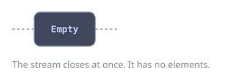</div>

```go [Code]
s := goflow.Empty[int]()
```

```go [Signature]
func Empty[T any]() Stream[T]
```

:::

### Pipe

Creates a writable stream entry point. Returns a `*Sender[T]` and the readable stream. `Send` blocks and returns `ErrClosed` or the send context's error; `Try` never blocks and returns `ErrFull` or `ErrClosed`. The entry point closes when `ctx` is done or `Close` is called. The stream and its stages run on `ctx` and stop when it ends. To drain a long-lived pipeline, use `PipeFunc`.

Options: `WithBuffer`, `WithName`, `WithMeterProvider`, `WithTracerProvider`.

::: code-group

<div class="vp-block active" data-title="Diagram"></div>

```go [Code]
send, s := goflow.Pipe[string](ctx, goflow.WithBuffer(16))
go func() {
    send.Send(ctx, "hello")
    send.Send(ctx, "world")
    send.Close(ctx)
}()
```

```go [Signature]
func Pipe[T any](ctx context.Context, opts ...Option) (*Sender[T], Stream[T])
```

:::

### PipeFunc

Creates a Pipe and launches the consumer `fn` in a `gofuncy.Go` goroutine. Returns only the `Sender`. `fn` and its stages run on a context that `ctx` does not cancel; `fn` must return when its stream ends. `Close(ctx)` waits until `fn` returns.

::: code-group

<div class="vp-block active" data-title="Diagram"></div>

```go [Code]
send := goflow.PipeFunc[int](ctx, func(ctx context.Context, s goflow.Stream[int]) error {
    return s.ForEach(func(_ context.Context, n int) error {
        fmt.Println(n)
        return nil
    })
})
send.Send(ctx, 42)
```

```go [Signature]
func PipeFunc[T any](ctx context.Context, fn func(context.Context, Stream[T]) error, opts ...Option) *Sender[T]
```

:::

---

## Transformers

### Map

Returns a new stream by applying `fn` to each element. If `fn` returns an error, the stream closes and the error is handled by `gofuncy.Go`.

::: code-group

<div class="vp-block active" data-title="Diagram"></div>

```go [Code]
doubled := goflow.Map(s, func(_ context.Context, n int) (int, error) {
    return n * 2, nil
})
```

```go [Signature]
func Map[T, U any](s Stream[T], fn func(context.Context, T) (U, error)) Stream[U]
```

:::

### FlatMap

Applies `fn` to each element, producing a sub-stream per element, and flattens the results into a single output stream sequentially.

::: code-group

<div class="vp-block active" data-title="Diagram"></div>

```go [Code]
expanded := goflow.FlatMap(s, func(ctx context.Context, n int) goflow.Stream[int] {
    return goflow.Of(ctx, n, n*10, n*100)
})
```

```go [Signature]
func FlatMap[T, U any](s Stream[T], fn func(context.Context, T) Stream[U]) Stream[U]
```

:::

### MapFilter

Maps and filters in a single pass. `(val, true, nil)` emits `val`; `(_, false, nil)` skips the item; `(_, _, err)` stops the stream.

::: code-group

<div class="vp-block active" data-title="Diagram"></div>

```go [Code]
parsed := goflow.MapFilter(s, func(_ context.Context, raw string) (int, bool, error) {
    n, err := strconv.Atoi(raw)
    if err != nil {
        return 0, false, nil // skip unparseable
    }
    return n, true, nil
})
```

```go [Signature]
func MapFilter[T, U any](s Stream[T], fn func(context.Context, T) (U, bool, error)) Stream[U]
```

:::

### Flatten

Flattens a stream of slices into a stream of individual elements.

::: code-group

<div class="vp-block active" data-title="Diagram"></div>

```go [Code]
flat := goflow.Flatten(goflow.Of(ctx, []int{1, 2}, []int{3, 4}))
// 1, 2, 3, 4
```

```go [Signature]
func Flatten[T any](s Stream[[]T]) Stream[T]
```

:::

### Reverse

Collects all elements and emits them in reverse order.

::: code-group

<div class="vp-block active" data-title="Diagram"></div>

```go [Code]
reversed := goflow.Of(ctx, 1, 2, 3).Reverse()
// 3, 2, 1
```

```go [Signature]
func (s Stream[T]) Reverse() Stream[T]
```

:::

::: warning
Reverse buffers the entire stream in memory before emitting. Do not use on unbounded streams.
:::

### Sort

Collects all elements, sorts them using `cmp`, and emits in sorted order.

::: code-group

<div class="vp-block active" data-title="Diagram"></div>

```go [Code]
sorted := goflow.Of(ctx, 3, 1, 2).Sort(func(a, b int) int { return a - b })
// 1, 2, 3
```

```go [Signature]
func (s Stream[T]) Sort(cmp func(T, T) int) Stream[T]
```

:::

::: warning
Sort buffers the entire stream in memory before emitting. Do not use on unbounded streams.
:::

### Split

Groups consecutive elements into batches of size `n`. The last batch may contain fewer than `n` elements.

::: code-group

<div class="vp-block active" data-title="Diagram"></div>

```go [Code]
batches := goflow.Split(goflow.Of(ctx, 1, 2, 3, 4, 5), 2)
// [1,2], [3,4], [5]
```

```go [Signature]
func Split[T any](s Stream[T], n int) Stream[[]T]
```

:::

### Window

Emits sliding windows of `n` consecutive elements. If the source has fewer than `n` elements, no windows are emitted.

::: code-group

<div class="vp-block active" data-title="Diagram"></div>

```go [Code]
windows := goflow.Window(goflow.Of(ctx, 1, 2, 3, 4), 3)
// [1,2,3], [2,3,4]
```

```go [Signature]
func Window[T any](s Stream[T], n int) Stream[[]T]
```

:::

### Batch

Groups consecutive elements into batches. A batch is flushed when it reaches `MaxItems(n)`, when the next element would push it over `MaxBytes(n, size)`, when `MaxWait(d)` has passed since its first element, or when the input closes (the partial batch is always flushed). Without options, Batch behaves like `MaxItems(1)`. An element larger than `MaxBytes` forms a batch of its own. The flush reason (`count`, `bytes`, `interval`, `close`) is recorded in metrics and spans.

Unlike `Split` (count only) and `Window` (sliding), Batch also flushes by size and time, which suits long-lived streams.

::: code-group

<div class="vp-block active" data-title="Diagram"></div>

```go [Code]
batches := goflow.Batch(events,
    goflow.MaxItems(200),
    goflow.MaxBytes(400<<10, func(e Event) int { return len(e.Payload) }),
    goflow.MaxWait(5*time.Second),
)
```

```go [Signature]
func Batch[T any](s Stream[T], opts ...Option) Stream[[]T]
```

:::

---

## Filters

### Filter

Returns a stream containing only elements where `fn` returns true.

::: code-group

<div class="vp-block active" data-title="Diagram"></div>

```go [Code]
evens := goflow.Of(ctx, 1, 2, 3, 4).Filter(func(_ context.Context, n int) bool {
    return n%2 == 0
})
```

```go [Signature]
func (s Stream[T]) Filter(fn func(context.Context, T) bool) Stream[T]
```

:::

### Distinct

Deduplicates elements using a key function. First occurrence wins.

::: code-group

<div class="vp-block active" data-title="Diagram"></div>

```go [Code]
unique := s.Distinct(func(item Item) string { return item.ID })
```

```go [Signature]
func (s Stream[T]) Distinct(key func(T) string) Stream[T]
```

:::

::: warning
Distinct maintains a map of all seen keys in memory. For streams with high cardinality, memory usage grows without bound.
:::

### Take

Emits the first `n` elements then closes the stream.

::: code-group

<div class="vp-block active" data-title="Diagram"></div>

```go [Code]
first3 := goflow.Of(ctx, 1, 2, 3, 4, 5).Take(3)
// 1, 2, 3
```

```go [Signature]
func (s Stream[T]) Take(n int) Stream[T]
```

:::

### Skip

Drops the first `n` elements and emits the rest.

::: code-group

<div class="vp-block active" data-title="Diagram"></div>

```go [Code]
rest := goflow.Of(ctx, 1, 2, 3, 4, 5).Skip(2)
// 3, 4, 5
```

```go [Signature]
func (s Stream[T]) Skip(n int) Stream[T]
```

:::

### Peek

Calls `fn` for each element as a side-effect and forwards the element unchanged. Useful for logging or debugging.

::: code-group

<div class="vp-block active" data-title="Diagram"></div>

```go [Code]
s.Peek(func(_ context.Context, n int) {
    log.Printf("processing: %d", n)
})
```

```go [Signature]
func (s Stream[T]) Peek(fn func(context.Context, T)) Stream[T]
```

:::

### Throttle

Rate-limits the stream to at most one element per duration `d`.

::: code-group

<div class="vp-block active" data-title="Diagram"></div>

```go [Code]
limited := s.Throttle(100 * time.Millisecond)
```

```go [Signature]
func (s Stream[T]) Throttle(d time.Duration) Stream[T]
```

:::

---

## Consumers

### Collect

Drains the stream and returns all elements as a slice.

::: code-group

<div class="vp-block active" data-title="Diagram"></div>

```go [Code]
items := goflow.Of(ctx, 1, 2, 3).Collect()
```

```go [Signature]
func (s Stream[T]) Collect() []T
```

:::

### Count

Returns the number of elements in the stream.

::: code-group

<div class="vp-block active" data-title="Diagram"></div>

```go [Code]
n := goflow.Of(ctx, 1, 2, 3).Count()
// 3
```

```go [Signature]
func (s Stream[T]) Count() int
```

:::

### ForEach

Consumes the stream, calling `fn` for each element. Returns the first error from `fn` or the context, nil when fully consumed. With `WithErrorHandler(h)`, errors from `fn` go to `h` and consumption continues; ForEach then only returns context errors or nil.

::: code-group

<div class="vp-block active" data-title="Diagram"></div>

```go [Code]
err := s.ForEach(func(_ context.Context, item Item) error {
    return db.Save(item)
})
```

```go [Signature]
func (s Stream[T]) ForEach(fn func(context.Context, T) error, opts ...Option) error
```

:::

### Reduce

Folds all elements into a single value using `fn`. Returns the accumulated result or the first error from `fn`.

::: code-group

<div class="vp-block active" data-title="Diagram"></div>

```go [Code]
sum, err := goflow.Reduce(goflow.Of(ctx, 1, 2, 3), 0,
    func(_ context.Context, acc, n int) (int, error) {
        return acc + n, nil
    },
)
```

```go [Signature]
func Reduce[T, U any](s Stream[T], initial U, fn func(context.Context, U, T) (U, error)) (U, error)
```

:::

### ToMap

Collects all stream elements into a map using the key and value functions. If duplicate keys occur, the last value wins.

::: code-group

<div class="vp-block active" data-title="Diagram"></div>

```go [Code]
m := goflow.ToMap(s, func(u User) string { return u.ID }, func(u User) User { return u })
```

```go [Signature]
func ToMap[T any, K comparable, V any](s Stream[T], key func(T) K, value func(T) V) map[K]V
```

:::

### FindFirst

Returns the first element and true, or the zero value and false if the stream is empty.

::: code-group

<div class="vp-block active" data-title="Diagram"></div>

```go [Code]
first, ok := s.FindFirst()
```

```go [Signature]
func (s Stream[T]) FindFirst() (T, bool)
```

:::

### FindFirstMatch

Returns the first element matching the predicate and true, or the zero value and false if no element matches.

::: code-group

<div class="vp-block active" data-title="Diagram"></div>

```go [Code]
admin, ok := s.FindFirstMatch(func(_ context.Context, u User) bool {
    return u.Role == "admin"
})
```

```go [Signature]
func (s Stream[T]) FindFirstMatch(fn func(context.Context, T) bool) (T, bool)
```

:::

### AllMatch

Returns true if all elements match the predicate. Short-circuits on the first non-matching element. Returns true for an empty stream.

::: code-group

<div class="vp-block active" data-title="Diagram"></div>

```go [Code]
allPositive := s.AllMatch(func(_ context.Context, n int) bool { return n > 0 })
```

```go [Signature]
func (s Stream[T]) AllMatch(fn func(context.Context, T) bool) bool
```

:::

### AnyMatch

Returns true if any element matches the predicate. Short-circuits on the first matching element. Returns false for an empty stream.

::: code-group

<div class="vp-block active" data-title="Diagram"></div>

```go [Code]
hasNegative := s.AnyMatch(func(_ context.Context, n int) bool { return n < 0 })
```

```go [Signature]
func (s Stream[T]) AnyMatch(fn func(context.Context, T) bool) bool
```

:::

### NoneMatch

Returns true if no elements match the predicate. Short-circuits on the first matching element. Returns true for an empty stream.

::: code-group

<div class="vp-block active" data-title="Diagram"></div>

```go [Code]
noErrors := s.NoneMatch(func(_ context.Context, r Result) bool { return r.Err != nil })
```

```go [Signature]
func (s Stream[T]) NoneMatch(fn func(context.Context, T) bool) bool
```

:::

### Min

Returns the minimum element according to `cmp` and true, or the zero value and false if the stream is empty.

::: code-group

<div class="vp-block active" data-title="Diagram"></div>

```go [Code]
smallest, ok := s.Min(func(a, b int) int { return a - b })
```

```go [Signature]
func (s Stream[T]) Min(cmp func(T, T) int) (T, bool)
```

:::

### Max

Returns the maximum element according to `cmp` and true, or the zero value and false if the stream is empty.

::: code-group

<div class="vp-block active" data-title="Diagram"></div>

```go [Code]
largest, ok := s.Max(func(a, b int) int { return a - b })
```

```go [Signature]
func (s Stream[T]) Max(cmp func(T, T) int) (T, bool)
```

:::

### Process

Consumes the stream with `n` long-lived workers. All errors are collected and returned via `errors.Join`. With `WithErrorHandler(h)`, errors go to `h` instead and are not retained. Use `WithGroupOptions(...)` to pass `gofuncy.GroupOption` values to the worker group.

::: code-group

<div class="vp-block active" data-title="Diagram"></div>

```go [Code]
err := s.Process(4, func(ctx context.Context, item Item) error {
    return upload(ctx, item)
})
```

```go [Signature]
func (s Stream[T]) Process(n int, fn func(context.Context, T) error, opts ...Option) error
```

:::

---

## Concurrency

### FanOut

Distributes elements round-robin across `n` output streams.

::: code-group

<div class="vp-block active" data-title="Diagram"></div>

```go [Code]
streams := s.FanOut(3)
```

```go [Signature]
func (s Stream[T]) FanOut(n int) []Stream[T]
```

:::

::: warning
FanOut blocks on the slowest consumer. If one output stream is not being consumed, the entire pipeline stalls.
:::

### FanIn

Combines multiple streams into a single stream. Elements arrive in non-deterministic order as they become available. Uses the context and options from the first stream.

::: code-group

<div class="vp-block active" data-title="Diagram"></div>

```go [Code]
merged := goflow.FanIn(streams)
```

```go [Signature]
func FanIn[T any](streams []Stream[T]) Stream[T]
```

:::

### FanMap

Fans out a stream into `n` partitions, maps each concurrently, and fans in the results. Output order is non-deterministic. This is a shorthand for `FanIn(MapEach(s.FanOut(n), fn))`.

::: code-group

<div class="vp-block active" data-title="Diagram"></div>

```go [Code]
results := goflow.FanMap(s, 4, func(ctx context.Context, url string) (Response, error) {
    return httpGet(ctx, url)
})
```

```go [Signature]
func FanMap[T, U any](s Stream[T], n int, fn func(context.Context, T) (U, error)) Stream[U]
```

:::

### FanMapFilter

Fans out, applies MapFilter concurrently, and fans in the results. Equivalent to `FanIn(MapFilterEach(s.FanOut(n), fn))`.

::: code-group

<div class="vp-block active" data-title="Diagram"></div>

```go [Code]
results := goflow.FanMapFilter(s, 4, func(ctx context.Context, id string) (User, bool, error) {
    u, err := fetchUser(ctx, id)
    if err != nil {
        return User{}, false, nil // skip failures
    }
    return u, true, nil
})
```

```go [Signature]
func FanMapFilter[T, U any](s Stream[T], n int, fn func(context.Context, T) (U, bool, error)) Stream[U]
```

:::

### Tee

Broadcasts every element to `n` output streams. Unlike FanOut which round-robins, Tee sends each element to all streams.

::: code-group

<div class="vp-block active" data-title="Diagram"></div>

```go [Code]
copies := s.Tee(2)
// copies[0] and copies[1] both receive every element
```

```go [Signature]
func (s Stream[T]) Tee(n int) []Stream[T]
```

:::

::: warning
Tee blocks on the slowest consumer. If any output stream is not consumed, the pipeline stalls. Consider adding buffered channels via Pipe if consumers have different speeds.
:::

### MapEach

Applies Map to each stream in a slice, returning a slice of transformed streams.

::: code-group

<div class="vp-block active" data-title="Diagram"></div>

```go [Code]
transformed := goflow.MapEach(streams, fn)
```

```go [Signature]
func MapEach[T, U any](streams []Stream[T], fn func(context.Context, T) (U, error)) []Stream[U]
```

:::

### MapFilterEach

Applies MapFilter to each stream in a slice.

::: code-group

<div class="vp-block active" data-title="Diagram"></div>

```go [Code]
filtered := goflow.MapFilterEach(streams, fn)
```

```go [Signature]
func MapFilterEach[T, U any](streams []Stream[T], fn func(context.Context, T) (U, bool, error)) []Stream[U]
```

:::

---

## Combinators

### Concat

Returns a stream that emits all elements from each input stream in order: first all elements from `streams[0]`, then `streams[1]`, and so on. Uses the context and options from the first stream.

::: code-group

<div class="vp-block active" data-title="Diagram"></div>

```go [Code]
all := goflow.Concat(s1, s2, s3)
```

```go [Signature]
func Concat[T any](streams ...Stream[T]) Stream[T]
```

:::

---

## Utility Methods

### Context

```go
func (s Stream[T]) Context() context.Context
```

Returns the stream's bound context.

### WithOptions

```go
func (s Stream[T]) WithOptions(opts ...gofuncy.GoOption) Stream[T]
```

Returns a shallow copy of the stream with the given options appended. Options are propagated to all downstream operators.

### Chan

::: code-group

<div class="vp-block active" data-title="Diagram"></div>

```go [Signature]
func (s Stream[T]) Chan() <-chan T
```

:::

Returns the underlying receive channel.

### Iter

::: code-group

<div class="vp-block active" data-title="Diagram"></div>

```go [Signature]
func (s Stream[T]) Iter() iter.Seq[T]
```

:::

Returns an `iter.Seq[T]` that yields each element of the stream. The returned iterator drains the stream and can only be used once.

### Iter2

::: code-group

<div class="vp-block active" data-title="Diagram"></div>

```go [Signature]
func (s Stream[T]) Iter2() iter.Seq2[int, T]
```

:::

Returns an `iter.Seq2[int, T]` that yields each element with its zero-based index. The returned iterator drains the stream and can only be used once.
